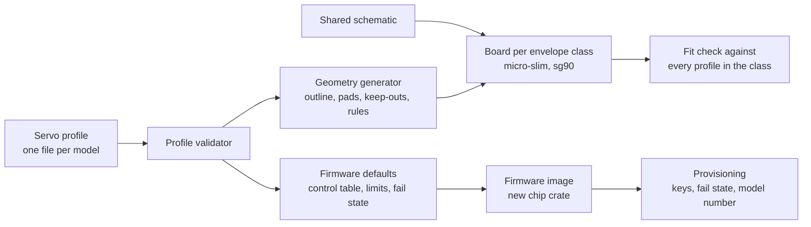
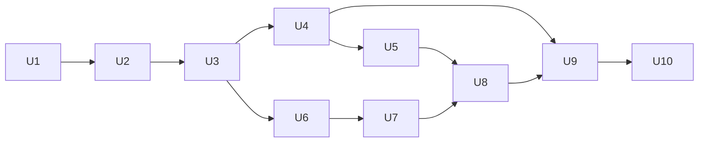

# Parametric Secure Microservo Board Family - Plan

**Target repo:** `open-servo-core-secure`. Paths are relative to this repository unless prefixed
`Serenity-UAV/`.

**Companion plan:** `Serenity-UAV/docs/plans/2026-11-16-001-feat-nozzle-servo-selection-osc-integration-plan.md`
(servo selection and aircraft integration). Cross-plan dependencies are named `SV-U<n>`.

**Author:** Steve Griffing, PE(CSE), CISSP-ISSEP, CEH (GitHub `Stab-Rabbit-coding`) — owner
decisions. **AI contribution:** research, analysis and plan text by Claude Fable 5.2 (Anthropic).

---

## Goal Capsule

- **Objective:** Turn the single SG90 swap board into a profile-driven family of secure
  smart-servo control boards, with a first slim board that fits the KST X06H, KST CM07, FrSky
  LD5801 and FrSky Act W5711A, built only from parts that pass the owner's sourcing and openness
  rule.
- **Use:** Serenity-UAV nacelle nozzle servos (slim board) and RCS bleed-valve and cargo servos
  (SG90 board), all on the authenticated osc-native bus.
- **Authority:** owner decisions in this plan's KTDs > `Serenity-UAV/AGENTS.md` "Component
  sourcing and openness" > this repository's `AGENTS.md` and normative docs > manufacturer
  datasheets > this plan.
- **Stop conditions:**
    - Stop at any sprint whose QA gate fails. Do not start a dependent sprint on a failed gate.
    - Stop before layout (U5) until the U2 teardown measurements exist for every profile the board
      claims to fit.
    - Stop and return to the owner if no compliant MCU fits the measured common envelope (U3).
    - Stop before ordering boards. Fabrication orders are an owner action.
- **Execution profile:** KiCad 10 hardware, Python generators and checkers, Rust `no_std`
  firmware, bench measurement. Sprints run in order of the Sequencing diagram.
- **Tail ownership:** each sprint closes with its QA gate record and owner sign-off (KTD6).

---

## Product Contract

### Summary

One servo profile file describes each servo model: its cavity, wire pads, motor, potentiometer,
voltage range and fail state. Generators turn a profile into the board outline, pad placement,
design rules and firmware defaults. Supporting another microservo is a new profile and a fit
check, not a new design.

### Problem Frame

- The only swap board, `osc-sg90-v006`, is 0.39 × 0.49 in (10 × 12.5 mm). The candidate nozzle
  servos are 0.24–0.30 in (6–7.5 mm) thick, so that board cannot go in any of them.
- The board's MCU is the WCH CH32V006 (PRC-domiciled maker) and its secure element is the
  Microchip ECC204, whose command set is published only under NDA (`TODO.md` §7.1, §7.4). Both
  fail the Serenity sourcing and openness rule. The owner chose a compliant re-target.
- Board geometry, pad positions and firmware constants are hand-entered per board today, and the
  SG90 board has open placement defects from that process (`TODO.md` §7.8, §10).

### Requirements

- **R1.** A versioned servo profile is the single source for every model-specific value. No
  model-specific constant appears in a generator, schematic, DRC rule or firmware source.
- **R2.** Board outline, wire-pad positions, keep-outs, height limits and design-rule values are
  generated from the profile's envelope class.
- **R3.** One slim board fits the X06H, CM07, LD5801 and W5711A cavities as measured in U2.
- **R4.** Every IC, discrete semiconductor and module passes the sourcing and openness rule;
  every reject is recorded with its reason.
- **R5.** The board accepts the full supply range of every profile it serves, at least
  3.5–8.4 V, and drives each profile's stall current with a profile-set current limit.
- **R6.** The bus is single-wire osc-native with per-message authentication as specified in
  `docs/security-architecture.md`, re-based on the new crypto hardware.
- **R7.** Firmware gains a chip crate for the new MCU under the existing provider pattern
  (`docs/driver-pattern.md`). Chip-agnostic crates stay chip-agnostic.
- **R8.** Loss-of-authenticated-command behaviour is a provisioned, per-profile value (hold,
  go to a set position, or release torque). It is never a compile-time constant.
- **R9.** The SG90 board is re-targeted through the same flow, as the `sg90` envelope class.
- **R10.** Every sprint ends in a QA gate with a written record. A sprint is not complete on
  engineering output alone.
- **R11.** A documented procedure adds a new servo model, and a fifth profile proves it.

### Scope Boundaries

- In scope: profile schema and tools, MCU and crypto selection, parametric schematic and board
  generation, slim-board layout, firmware port, security port, bench validation, SG90 re-target.
- Out: servo selection for the nozzle and aircraft integration (companion plan); brushless
  variants (`osc-dev-m007`); magnetic-encoder upgrades (`docs/sg90-*-encoder-upgrade.md`).
- Out: DO-326A assessment and export classification (`TODO.md` §7.6, §7.7 remain open there).

#### Deferred to Follow-Up Work

- Upstreaming the parametric flow to `OpenServoCore/open-servo-core`.
- Retiring `firmware/servo-ch32` once the new chip crate is bench-proven; until then it builds
  as a non-flight reference.

### Outstanding Questions

- **Deferred to U2:** internal cavity and stock-board dimensions of all four servos. None is
  published.
- **Deferred to U3:** discrete secure element or MCU key storage alone. See KTD3.
- **Deferred to U3:** Rust HAL and PAC maturity for the selected MCU — requires verification.
- **Deferred to U7:** whether the ECC204-specific analytical timing budget
  (`docs/security-architecture.md` §2.6) survives the crypto change; it is re-measured, not
  assumed.

### Sources

- `hardware/X06H2021423-172435499.pdf` — KST X06H Technical Specification, 2021-03.
- `hardware/CM07_Technical_Specifcation.pdf` — KST CM07 Technical Specification, 2026-05.
- `hardware/ld5801-4.webp`, `hardware/frsky-xact-5800.png` — FrSky LD5801 dimension sheet and
  lug-variant image (owner-supplied; source page not catalogued).
- <https://www.frsky-rc.biz/ws/frsky-act-w5711a.html> — FrSky Act W5711A, read 2026-11-16.
- `Serenity-UAV/avionics/datasheets/ti/mspm0g3518-q1.pdf`, `mspm0g3507.pdf`, `mspm0l1105.pdf` —
  TI device features and package lists, first pages read 2026-11-16.
- `hardware/boards/osc-sg90-v006/README.md`, `docs/security-architecture.md`, `TODO.md` §7, §10.
- `Serenity-UAV/AGENTS.md` "Component sourcing and openness (owner rule, 2026-10-17)".

---

## Planning Contract

### Key Technical Decisions

- **KTD1 — Profile-driven family** *(session-settled: user-directed — chosen over a one-off X06H
  board: "maximize parameterization so that it can easily be modified for other microservo
  models")*. A profile carries: envelope class, cavity and keep-out geometry, wire-pad positions,
  supply range, motor resistance and stall current per voltage, potentiometer value and
  electrical travel, output travel, thermal limits, control defaults, fail state, model number.
- **KTD2 — One common-envelope slim board** *(session-settled: user-directed — chosen over an
  X06H-specific outline, so the servo choice can change without a respin)*. The board is sized to
  the intersection of the four measured cavities. Published case thicknesses bound it: 0.236 in
  (6 mm, W5711A) to 0.295 in (7.5 mm, CM07). The W5711A is expected to govern width.
- **KTD3 — Compliant re-target** *(session-settled: user-directed — chosen over a recorded waiver
  and over a bench-only CH32 build)*. U3 selects the parts. Candidates, from datasheets on hand:

  | Candidate | Verified facts | Position |
  | --- | --- | --- |
  | TI MSPM0G3518-Q1, 32-pin VQFN (RHB) | 256 KB flash, 128 KB SRAM, AES-128/256 with GCM, secure storage for four AES keys | Primary. Same MCU as the Serenity gateways. May remove the discrete secure element. Package width against the envelope requires verification. |
  | TI MSPM0G350x, 32-pin VQFN or 28-pin VSSOP, plus Infineon OPTIGA Trust M | Up to 128 KB flash, 32 KB SRAM, AES; no key storage per fleet record | Fallback if the G3518 keystore cannot carry the identity plane. Costs board area for the secure element. |
  | TI MSPM0L110x, 16-pin WQFN or SOT | 64 KB flash, 4 KB SRAM | Rejected unless U3 shows the firmware fits 4 KB; today's budget is 8 KB. |
  | WCH CH32V006 | — | Rejected: PRC-domiciled maker. |
  | Microchip ECC204 | Command set NDA-only | Rejected: fails the openness rule. |

- **KTD4 — Schematic is shared; geometry is generated.** One hierarchical schematic serves every
  envelope class. Generators own outline, pads, keep-outs and rule values. Routing is done once
  per envelope class and is never regenerated over (fleet lesson: regenerating a packed board
  destroys manual work).
- **KTD5 — Retain proven analog blocks where compliant.** TI DRV8837 bridge and TI SN74LVC1G07
  bus buffer stay, subject to the U1 audit. The Nexperia PESD5V0L1UL bus TVS fails the rule
  (Wingtech-owned) and is replaced. The LDO's maker requires verification.
- **KTD6 — Sprint and QA gate structure** *(session-settled: user-directed — "all steps should
  be set up as sprints with a qa gate")*. Each unit is one sprint. Its gate has four parts:
    1. the unit's test scenarios pass;
    2. the standing checks in the Verification Contract pass;
    3. a negative control shows each new checker can fail;
    4. a gate record is written to `docs/qa/` and the owner signs it.
- **KTD7 — Bench before flight.** The existing `osc-dev-v006` dev board and CH32 firmware remain
  the reference for protocol behaviour during the port. Nothing built on them is a flight
  article.

### High-Level Technical Design

### Assumptions

- A gutted servo body (motor, gears, potentiometer, case) contains no semiconductor, so the
  sourcing rule applies to the swap board, not to the KST or FrSky body. Owner confirmation is
  requested at the U1 gate.
- All four candidates use a brushed coreless motor and a potentiometer, as their sheets state
  (LD5801: not stated; U2 confirms).

### Sequencing

---

## Implementation Units

### U1. Sprint 0 — Baseline, sourcing audit and source filing

**Goal:** A clean, rule-compliant starting record.

**Requirements:** R4, R10.

**Dependencies:** none.

**Files:** `AGENTS.md`; `REFERENCES.md`; `TODO.md`; `PROJECT_INDEX.md`;
`docs/sourcing-audit.md` (new); `hardware/datasheets/` (new, per-maker folders);
`docs/qa/README.md` (new, gate-record template).

**Approach:**

1. Add the sourcing and openness rule to `AGENTS.md`, citing the Serenity rule as its origin.
2. Audit every part on `osc-sg90-v006` by maker domicile and datasheet openness. Record passes
   and rejects, including the CH32V006, ECC204 and PESD5V0L1UL.
3. Move the six untracked servo files from `hardware/` into `hardware/datasheets/` and catalogue
   each in `REFERENCES.md`. Mark the LD5801 source page "requires verification".
4. Write the gate-record template.

**Test scenarios:**

- Every BOM line of `osc-sg90-v006` appears in the audit with maker, domicile and verdict.
- A deliberately PRC-made part added to a scratch BOM is reported as a reject.
- Every new REF-ID is cited from at least one repository location.

**Verification:** audit complete; Markdown lint clean; gate record signed.

### U2. Sprint 1 — Teardown and servo profiles

**Goal:** Measured profiles for the four slim candidates and the SG90.

**Requirements:** R1, R3.

**Dependencies:** U1. Feeds `SV-U3`.

**Files:** `profiles/schema.json` (new); `profiles/kst-x06h.yaml`, `profiles/kst-cm07.yaml`,
`profiles/frsky-ld5801.yaml`, `profiles/frsky-act-w5711a.yaml`, `profiles/sg90.yaml` (new);
`tools/profile/validate.py` (new); `tools/profile/tests/test_validate.py` (new);
`docs/teardown/` (new, one measured record per model with photographs).

**Approach:**

1. Open one unit of each model. Measure the board cavity, the stock board, wire-pad positions,
   motor terminal resistance, potentiometer resistance and electrical travel.
2. Enter published values with their REF-ID and measured values with the teardown record. Mark
   each field `published`, `measured` or `requires-verification`.
3. The validator rejects missing fields, unit errors, and any field with no source.

**Execution note:** Write the validator test-first; the profiles are its fixtures.

**Test scenarios:**

- Each of the five profiles validates.
- A profile with a missing cavity dimension fails with the field named.
- A profile whose stall current exceeds the bridge rating fails.
- A value with no REF-ID or teardown reference fails.
- X06H published fields match its sheet: case 0.787 × 0.276 × 0.654 in (20 × 7 × 16.6 mm),
  3.8–8.4 V, stall current 0.58 A at 6.0 V.

**Verification:** validator tests pass; five teardown records filed; gate record signed.

### U3. Sprint 2 — MCU and crypto selection, security-architecture delta

**Goal:** Selected parts and a revised security design.

**Requirements:** R4, R6, R8.

**Dependencies:** U2.

**Files:** `docs/mcu-crypto-trade.md` (new); `docs/security-architecture.md`;
`REFERENCES.md`; `TODO.md` §7.

**Approach:**

1. Score the KTD3 candidates on: package fit in the measured envelope, pin count against the
   SG90 board's net list, flash and SRAM against measured firmware size, crypto and key storage,
   Rust toolchain support, datasheet openness. List every package each part is offered in.
2. Decide discrete secure element or MCU key storage. State what the identity plane loses or
   keeps in each case.
3. Revise `docs/security-architecture.md`: replace ECC204-specific sections, keep the
   three-plane structure, and label every timing figure analytical until U7 measures it.
4. Close or re-point each `TODO.md` §7 item; leave none open whose text says superseded.

**Test scenarios:**

- Every candidate has a sourced value or a "requires verification" mark for each criterion.
- The selected MCU's pin map covers every net of the shared schematic with no double use.
- The revised architecture still rejects replayed and unauthenticated frames in its threat
  model walk-through.

**Verification:** owner accepts the selection at the gate. A "no candidate fits" result is a
stop.

### U4. Sprint 3 — Shared schematic and geometry generator

**Goal:** One schematic and a generator that emits board geometry per envelope class.

**Requirements:** R1, R2, R5.

**Dependencies:** U3.

**Files:** `hardware/boards/osc-servo-core/` (new shared schematic sheets);
`hardware/tools/gen_board_geometry.py` (new); `hardware/tools/tests/test_gen_board_geometry.py`
(new); `hardware/boards/osc-micro-slim/` (new board project and commentary Markdown).

**Approach:**

1. Capture the shared schematic from `osc-sg90-v006` with the U3 parts. Size the shunt and
   current limit from profile stall current.
2. The generator computes the common envelope across a class's profiles and writes outline,
   wire pads, keep-outs and rule values. It refuses to overwrite a routed board.
3. Put design-rule commentary in the accompanying Markdown; the rule file admits no comments.

**Test scenarios:**

- The `micro-slim` envelope is no larger than any member profile's cavity on any axis.
- Adding a smaller fifth profile shrinks the envelope; removing it restores the prior result.
- Running the generator against a board that has tracks exits non-zero and changes nothing.
- ERC reports zero errors.
- A design-rule minimum raised to an absurd value changes the DRC count (rules are firing).

**Verification:** generator tests pass; ERC clean; gate record signed.

### U5. Sprint 4 — Slim board layout and fit proof

**Goal:** A routed slim board that fits all four cavities.

**Requirements:** R2, R3, R5.

**Dependencies:** U4, and U2 measurements for all four profiles.

**Files:** `hardware/boards/osc-micro-slim/` board, fabrication outputs and `README.md`;
`hardware/tools/check_cavity_fit.py` (new) and its test.

**Approach:**

1. Place and route by hand or autorouter on the generated outline. Follow the fabricator limits
   already cited as REF-FAB-001.
2. Check the populated board's 3D envelope against each profile's cavity and wire-pad reach.

**Test scenarios:**

- DRC: zero errors, zero unconnected items, with the rule-fire proof repeated.
- Cavity fit passes for X06H, CM07, LD5801 and W5711A.
- A component moved 0.04 in (1 mm) outside the envelope fails the fit check.
- Hole-to-edge check agrees with DRC.

**Verification:** fit report clean for four profiles; gate record signed. Ordering boards is
the owner's action after this gate.

### U6. Sprint 5 — Firmware chip crate and profile-driven configuration

**Goal:** The firmware runs on the new MCU and takes its model values from the profile.

**Requirements:** R1, R7.

**Dependencies:** U3.

**Files:** `firmware/servo-<mcu>/` (new chip crate); `firmware/boards/osc-micro-slim/` (new);
`firmware/lib/table-export/`; `tools/profile/gen_firmware_defaults.py` (new) and its test;
`descriptors/`; `docs/driver-pattern.md`; `docs/osc-servo-transport.md`.

**Approach:**

1. Implement the HAL and provider layer for the new MCU behind the existing traits. Keep the
   transport's deadline pipeline and hardware-CRC behaviour.
2. Generate control-table defaults and limits from the profile.
3. State the flash and SRAM cost of the port.

**Patterns to follow:** `firmware/servo-ch32/` provider layout; `firmware/lib/integration/`
discrete-event tests.

**Test scenarios:**

- The chip-agnostic integration suite passes unchanged.
- Generated defaults for X06H carry its travel (±60°) and supply limits from the profile.
- A profile change regenerates the descriptor; a stale descriptor fails the check.
- `cargo clippy` is clean with warnings denied.

**Verification:** host tests pass; image size reported; gate record signed.

### U7. Sprint 6 — Security port and provisioning

**Goal:** Authenticated bus operation and provisioned fail state on the new crypto hardware.

**Requirements:** R6, R8.

**Dependencies:** U6.

**Files:** `firmware/lib/osc-security/`; `firmware/lib/drivers/`; `client/src/session.rs`,
`client/examples/provision.rs`; `docs/security-architecture.md`; `docs/osc-native-protocol.md`
§11.

**Approach:**

1. Port the session and message planes. Write no constant that is not traced to a public
   document; prefer a compile gate over a stub.
2. Provision keys, model number and fail state per unit. Record the provisioning audit trail.
3. Measure per-frame cost and turnaround on silicon and replace the analytical figures.

**Test scenarios:**

- A frame with a bad tag is rejected and logged; actuator state does not change.
- A replayed frame and a stale-epoch frame are rejected.
- On loss of authenticated command, a unit provisioned "go to position" moves there; one
  provisioned "hold" holds; one provisioned "release" releases torque.
- An unprovisioned unit refuses to arm.
- Measured timing is recorded as new `[Fn]` facts.

**Verification:** security tests pass on hardware; timing facts recorded; gate record signed.

### U8. Sprint 7 — Bring-up and per-profile bench validation

**Goal:** Measured evidence that the slim board drives each candidate servo.

**Requirements:** R3, R5, R10. Feeds `SV-U6`.

**Dependencies:** U5, U7, and delivered boards.

**Files:** `docs/bench/` (new, one record per profile); `hardware/boards/osc-micro-slim/README.md`;
`profiles/*.yaml` (measured fields).

**Approach:** install the board in one unit of each model. Measure position accuracy, step
response, stall current against the profile, board and case temperature at sustained holding
load, and supply-range operation.

**Test scenarios:**

- Each servo reaches commanded positions across its travel within the profile's tolerance.
- Current limit trips at the profile value.
- Holding the profile's rated continuous torque for 10 min, the measured case temperature rise
  added to the highest expected installed ambient stays at or below the profile's upper limit
  (149 °F (65 °C) for the KST sheets).
- Operation at 3.5 V and 8.4 V supply.

**Verification:** four bench records filed; profile fields updated from `published` to
`measured`; gate record signed.

### U9. Sprint 8 — SG90 board re-target

**Goal:** The SG90 board rebuilt through the parametric flow on compliant parts.

**Requirements:** R4, R9.

**Dependencies:** U4, U8.

**Files:** `hardware/boards/osc-sg90/` (new board project); `firmware/boards/osc-sg90/` (new);
`hardware/boards/osc-sg90-v006/README.md` (superseded notice); `ARCHIVE_INDEX.md`.

**Approach:** generate the `sg90` envelope from its profile, route, fit-check and bench as in
U5 and U8. Mark `osc-sg90-v006` superseded with the reason; do not delete it.

**Test scenarios:**

- DRC zero errors; cavity fit passes for the SG90 profile.
- The same firmware source builds for both boards with only the profile differing.
- Fail state provisioned "go to closed" drives the output to its closed end (the RCS valve
  case).

**Verification:** bench record filed; gate record signed.

### U10. Sprint 9 — New-model procedure and release records

**Goal:** A proven procedure for adding a servo model.

**Requirements:** R11.

**Dependencies:** U9.

**Files:** `docs/adding-a-servo-model.md` (new); `README.md`; `PROJECT_INDEX.md`; `TODO.md`;
`REFERENCES.md`.

**Approach:** write the procedure, then follow it for a fifth model the owner names, without
editing any generator, schematic or firmware source.

**Test scenarios:**

- The fifth profile validates, and either fits an existing envelope class or reports the axis
  on which it does not.
- A repository search finds no model-specific constant outside `profiles/`.

**Verification:** procedure followed end to end by someone other than its author; gate record
signed.

---

## Verification Contract

Standing checks, run at every sprint gate:

- KiCad 10 `kicad-cli sch erc` and `pcb drc` at `--severity-all`, with the rule-fire proof. Use
  the KiCad 10 AppImage; the system `kicad-cli` 9.0.2 cannot load these files.
- `cargo clippy` with warnings denied and the host test suites in `firmware/lib` and `client`.
- Python tests for every tool under `tools/` and `hardware/tools/`, plus static analysis.
- Markdown lint with all rules, and `tools/precommit_doc_wording.py`.
- Sourcing audit re-run on any changed BOM.
- `REFERENCES.md` citation check: no fabricated, uncited or unverified-but-unmarked entry.

## Definition of Done

- U1–U10 complete, each with a signed gate record in `docs/qa/`.
- The slim board fits and drives all four candidates; the SG90 board is re-targeted.
- No part on either board fails the sourcing and openness rule.
- No model-specific constant exists outside `profiles/`.
- Every timing and thermal claim is measured, or labelled analytical with a `TODO.md` gate.
- Abandoned experiments, scratch boards and dead generator paths are removed from the tree.
- Measurements are imperial-primary with metric in parentheses; electrical quantities in SI.
- AI and human contributions are attributed in touched file headers and commit messages.
